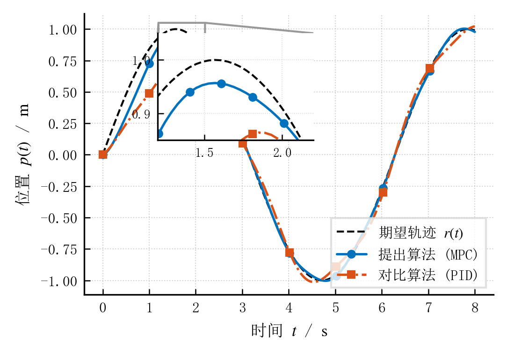
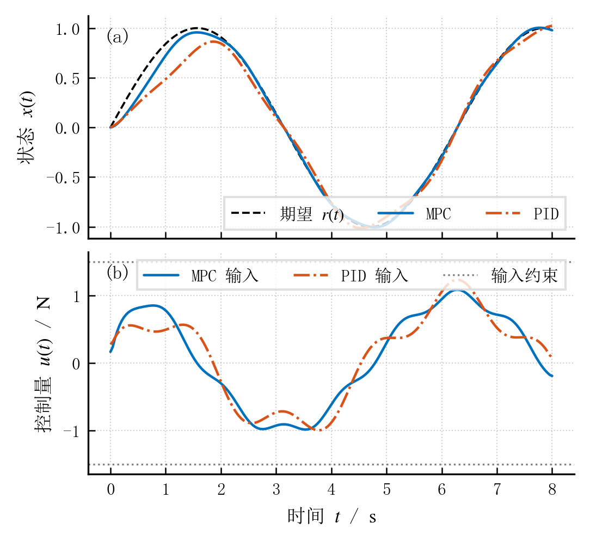

在撰写学术期刊论文（如 IEEE Transactions、国内核心期刊或学位论文）与科研实验记录时，绘图不仅需要解决中文字体与数学公式的正常显示，更需要满足出版级（Camera-Ready）的严格排版规范。许多论文配图在初稿阶段常出现**字号在缩放后变成不可读的“蚂蚁字”、线宽发虚、黑白打印无法区分**，或在提交给投稿系统（如 IEEE PDF eXpress）时因**字体未嵌入（Font not embedded）**而被拒收。

本文从跨平台中文字体探查出发，详细介绍如何通过 Matplotlib 构建符合学术出版标准的绘图工作流，涵盖物理版面尺寸对齐、字号层级、Type 42 矢量嵌入、黑白/色盲友好的双重编码，以及多子图规范排版与局部细节放大。

---

## 1. 字体探测与 Mathtext 公式渲染

### 1.1 确认系统可用中文字体

中文字体在不同操作系统中的内置名称各异（如 Windows 常用宋体/微软雅黑，macOS 为 Songti SC，Linux 多为 Noto Serif CJK）。在配置前，应先通过 Matplotlib 的字体管理器确认当前环境可用的中文字体真实名称：

```python
from matplotlib import font_manager

# 筛选系统中包含常用中文字体关键词的真实注册名称
available_fonts = sorted({f.name for f in font_manager.fontManager.ttflist})
cjk_candidates = ("SimSun", "Songti", "Noto", "YaHei", "Heiti", "STSong")
found_cjk = [name for name in available_fonts if any(k.lower() in name.lower() for k in cjk_candidates)]

print("检测到可用的中文字体候选：")
print("\n".join(found_cjk))
```

配置中的字体列表是按优先级回退的候选名单，Matplotlib 不会自动下载缺失字体。建议在衬线字体（serif）首选宋体系列，非衬线字体（sans-serif）首选微软雅黑或黑体系列。

### 1.2 Mathtext 渲染机制与语法边界

当 `text.usetex=False`（默认设置）时，公式由 Matplotlib 内置的 **Mathtext** 引擎解析，无需在本地安装庞大的 TeX 发行版（如 TeX Live / MiKTeX）。

- **优点**：跨平台轻量、渲染速度极快、不依赖外部可执行文件。
- **边界**：Mathtext 仅支持标准 TeX 数学语法的常用子集（如上下标、分式、根号、常用希腊字母与符号），不支持 LaTeX 宏包（如 `\usepackage{amsmath}`）、自定义宏定义或复杂表格环境。
- 详情可参考 [Matplotlib 官方数学文本说明](https://matplotlib.org/stable/users/explain/text/mathtext.html)。

---

## 2. 出版级科研绘图的核心原则

### 2.1 物理版面尺寸对齐（拒绝后期任意缩放）

很多论文插图难以阅读的根源在于：**先在电脑上以 800×600 或全屏大画布画图，然后在 LaTeX 排版时使用 `\includegraphics[width=\columnwidth]{...}` 强制等比例缩小**。这会导致原本设定的 10 pt 字号缩水成 4~5 pt 的“蚂蚁字”，原本 1 pt 的线宽缩得难以辨认。

**出版级金科玉律：直接按期刊最终版面的物理尺寸创建画布！**

- **双栏排版（IEEE Transactions, AIAA, ACM, 自动化学报等）**：
  - 单栏宽度（Single-column）：通常为 **3.5 英寸**（约 88.9 mm）。
  - 双栏全宽（Double-column / Span full width）：通常为 **7.0 ~ 7.16 英寸**（约 178 ~ 182 mm）。
- **单栏或 1.5 栏排版（Nature, Elsevier 等）**：
  - 单栏：约 89 mm（3.5 in）。
  - 1.5 栏：约 120 ~ 140 mm（4.7 ~ 5.5 in）。
  - 全宽：约 180 mm（7.1 in）。

在 Python 中以英寸为单位直接指定 `figsize=(3.5, 2.4)`。这样在 LaTeX 中以 `width=\columnwidth`（100% 原始比例）插入时，图像文字尺寸与论文正文字体完美统一。

### 2.2 出版级字体层级（Font Hierarchy）

学术出版物对图表字号有清晰的视觉梯队要求。若论文正文为 10 pt，图表内的字号梯队通常规划如下：

| 图表元素 | 推荐字号 | 说明 |
| :--- | :--- | :--- |
| **主坐标轴标签 (Axis Labels)** | 8.0 ~ 8.5 pt | 仅次于正文字号，确保物理量和单位醒目 |
| **刻度数字 (Tick Labels)** | 7.0 ~ 7.5 pt | 略小于标签，避免数值与坐标轴打架 |
| **图例标注 (Legend Text)** | 7.0 ~ 7.5 pt | 紧凑清晰，必要时采用多列排布 |
| **子图标号 ((a), (b))** | 8.5 ~ 9.0 pt | 加粗显示，统一锚定在子图左上角 |
| **局部细节 / 次要注释** | 6.5 ~ 7.0 pt | 不得小于 **6 pt**（绝大多数国际期刊的印刷底线） |

### 2.3 矢量图导出与 Type 42 字体嵌入（过审 IEEE PDF eXpress）

期刊投稿系统（如 IEEE PDF eXpress）对 PDF 往往有强制性要求：**All fonts must be embedded（所有字体必须嵌入），严禁使用 Type 3 位图字体**。

Matplotlib 默认在生成 PDF / PostScript 时可能将部分特殊字符生成未嵌入字体或位图。通过以下核心设置可强制启用 TrueType 嵌入：

```python
"pdf.fonttype": 42,  # 42 代表 TrueType 字体嵌入，杜绝 Type 3
"ps.fonttype": 42,
```

- **格式选型原则**：
  - 折线图、控制响应图、散点图、框图：**务必导出为矢量 PDF 或 EPS**，无任何缩放失真；
  - 极端密集散点（如数百万个粒子轨迹、CFD 切片）：若全部转为矢量会导致 PDF 高达数十兆且编译卡顿，可在绘制数据层时显式加上 `rasterized=True`，实现“曲线数据光栅化，坐标轴与文字保持纯矢量”的黄金平衡。

### 2.4 视觉无障碍与“双重编码”（Dual-Encoding）

1. **避免饱和纯红绿**：全球约有 8% 的男性存在红绿色觉缺陷。推荐使用感知均匀的色盘，或学术界常用的科技色标（如 `#0072BD` 经典深蓝、`#D95319` 砖红、`#EDB120` 琥珀黄等）。
2. **黑白打印友好（双重编码法则）**：审稿人常将论文黑白打印或复印阅读。**切勿仅凭颜色区分曲线**，必须同时借助 **线型（实线、虚线、点划线）** 与 **离散标记点（Marker: `o`, `s`, `^`）** 进行双重识别。
3. **标记稀疏化（`markevery`）**：高采样点数据如果全加上 marker 会连成粗斑，使用 `markevery=25` 可保持典雅稀疏的标记间距。

### 2.5 国际标准单位与量纲规范（物理量斜体 vs 单位数学正体）

在学术论文图表中，坐标轴物理量与单位的排版有非常严格的国际标准（ISO 80000-1、NIST）与国家标准（GB 3100/3101/3102）：

1. **物理量符号一律使用斜体（Italic）**：如时间 $t$、位移 $x$、质量 $m$、作用力 $F$、控制输入 $u$；
2. **计量单位符号一律使用正体（Roman / Upright）**：如秒 $\mathrm{s}$、米 $\mathrm{m}$、牛顿 $\mathrm{N}$、千克 $\mathrm{kg}$、弧度 $\mathrm{rad}$。

**为什么不能直接在数学模式写 `$t/s$` 或在文本写 `时间 $t$ / s`？**
- **含义混淆**：若在数学公式中直接写斜体 `$s$` 或 `$m$`，斜体 $s$ 代表位移或拉普拉斯复频率，正体 $\mathrm{s}$ 才代表时间单位秒；斜体 $m$ 代表质量（mass），正体 $\mathrm{m}$ 才代表长度单位米。
- **字体与基线脱节**：若写成文本 `"时间 $t$ / s"`，最后的 `s` 属于普通文本字符。在中英混排环境下，普通西文字符可能会调用中文字体（如宋体）自带的西文半角字形，导致其字重、字高、衬线风格与 STIX/Times 公式中的数字和符号产生微妙的不协调。
- **出版级规范解法**：**将单位包裹进数学环境，并使用 `\mathrm{...}` 正体宏**。例如 `r"时间 $t$ / $\mathrm{s}$"` 或 `r"时间 $t\ (\mathrm{s})$"`。这样单位与物理量共享 STIX 字体库，字形基线严丝合缝，同时完全符合量纲正体规范。

---

## 3. 开箱即用的出版级配置模板

通过封装函数与 `plt.rc_context`，可使局部绘图配置与全局环境完全隔离，即插即用：

```python
def get_publication_rc(column="single", lang="chinese"):
    """
    获取出版级 Matplotlib rcParams 配置字典。
    
    参数:
        column: "single"（单栏约 3.5 英寸）或 "double"（双栏约 7.0 英寸）
        lang: "chinese"（中英文混排：宋体 + Times New Roman + STIX）
              "english"（国际英文：Times New Roman + STIX）
    """
    width = 3.5 if column == "single" else 7.0
    height = 2.4 if column == "single" else 2.8

    serif_fonts = (
        ["SimSun", "Times New Roman", "DejaVu Serif"]
        if lang == "chinese"
        else ["Times New Roman", "DejaVu Serif"]
    )

    return {
        # 物理画布尺寸与渲染后端
        "figure.figsize": (width, height),
        "figure.dpi": 150,
        "savefig.dpi": 300,
        
        # 字体家族与数学集合
        "text.usetex": False,
        "font.family": "serif",
        "font.serif": serif_fonts,
        "mathtext.fontset": "stix",
        
        # 解决 IEEE PDF eXpress 字体未嵌入问题（强制嵌入 TrueType）
        "pdf.fonttype": 42,
        "ps.fonttype": 42,
        
        # 规范出版级字号梯度
        "font.size": 8.0,
        "axes.labelsize": 8.5,
        "axes.titlesize": 9.0,
        "xtick.labelsize": 7.5,
        "ytick.labelsize": 7.5,
        "legend.fontsize": 7.5,
        
        # 坐标轴与刻度外观：采用更内敛紧凑的内向刻度
        "axes.linewidth": 0.8,
        "xtick.direction": "in",
        "ytick.direction": "in",
        "xtick.major.width": 0.6,
        "ytick.major.width": 0.6,
        "xtick.major.size": 3.0,
        "ytick.major.size": 3.0,
        
        # 图例外观规范
        "legend.frameon": True,
        "legend.edgecolor": "0.85",
        "legend.fancybox": False,
        "legend.borderaxespad": 0.5,
        
        # 关键兼容设置：防止 Matplotlib 3.10+ 在中文字体下因负号报错
        "axes.unicode_minus": False,
        "axes.formatter.use_mathtext": False,
    }
```

---

## 4. 实战案例展示

### 4.1 案例一：IEEE 单栏标准控制跟踪曲线（含局部放大 Inset）

在控制理论与机器人学论文中，常需展示闭环跟踪效果与稳态细节放大图：

```python
import matplotlib.pyplot as plt
import numpy as np

# 模拟控制系统阶跃/正弦响应数据
t = np.linspace(0, 8, 200)
ref = np.sin(t)
prop = ref * (1 - np.exp(-2.0 * t)) + 0.015 * np.sin(6 * t)
base = ref * (1 - np.exp(-1.0 * t)) + 0.06 * np.sin(4 * t)

cfg = get_publication_rc(column="single", lang="chinese")

with plt.rc_context(cfg):
    fig, ax = plt.subplots(figsize=(3.5, 2.4), layout="constrained")
    
    # 双重编码：颜色 + 线型 + 稀疏标记
    ax.plot(t, ref, "k--", label=r"期望轨迹 $r(t)$", linewidth=1.0)
    ax.plot(t, prop, color="#0072BD", linestyle="-", marker="o", markevery=25,
            label=r"提出算法 (MPC)", linewidth=1.2)
    ax.plot(t, base, color="#D95319", linestyle="-.", marker="s", markevery=25,
            label=r"对比算法 (PID)", linewidth=1.2)
    
    # 规范国际标准单位表达：物理量用斜体，单位用数学正体 \mathrm{...}
    ax.set_xlabel(r"时间 $t$ / $\mathrm{s}$")
    ax.set_ylabel(r"位置 $p(t)$ / $\mathrm{m}$")
    ax.grid(True, linestyle=":", alpha=0.6, linewidth=0.5)
    ax.legend(loc="lower right")
    
    # 局部特征放大图（Inset Zoom）展示稳态收敛精度
    axins = ax.inset_axes([0.18, 0.55, 0.38, 0.38])
    axins.plot(t, ref, "k--", linewidth=1.0)
    axins.plot(t, prop, color="#0072BD", linestyle="-", marker="o", markevery=5, linewidth=1.2)
    axins.plot(t, base, color="#D95319", linestyle="-.", marker="s", markevery=5, linewidth=1.2)
    axins.set_xlim(1.2, 2.2)
    axins.set_ylim(0.85, 1.05)
    axins.grid(True, linestyle=":", alpha=0.5, linewidth=0.4)
    axins.tick_params(labelsize=6.5)
    ax.indicate_inset_zoom(axins, edgecolor="0.5", alpha=0.8)
    
    fig.savefig("pub-single-column.png", dpi=300)
    plt.close(fig)
```

**实测输出效果：**



*图 1：符合 IEEE 3.5 英寸物理单栏尺寸的跟踪响应曲线，包含宋体+Times New Roman混排、STIX公式、内向刻度、正体单位与局部稳态细节放大（300 DPI 出版级 PNG 输出）。*

---

### 4.2 案例二：双子图纵向堆叠（共享坐标轴与约束边界）

展示系统状态变量与控制输入时，应通过共享横坐标消除内侧刻度，节约版面空间：

```python
cfg = get_publication_rc(column="single", lang="chinese")

with plt.rc_context(cfg):
    # 共享横坐标时间轴，高度调整至 3.2 英寸
    fig, (ax1, ax2) = plt.subplots(2, 1, figsize=(3.5, 3.2), sharex=True, layout="constrained")
    
    # 子图 (a)：状态跟踪
    ax1.plot(t, ref, "k--", label=r"期望 $r(t)$", linewidth=0.9)
    ax1.plot(t, prop, color="#0072BD", linestyle="-", label="MPC", linewidth=1.1)
    ax1.plot(t, base, color="#D95319", linestyle="-.", label="PID", linewidth=1.1)
    ax1.set_ylabel(r"状态 $x(t)$")
    ax1.grid(True, linestyle=":", alpha=0.6, linewidth=0.5)
    ax1.legend(loc="lower right", ncol=3)
    ax1.text(0.03, 0.88, "(a)", transform=ax1.transAxes, fontweight="bold", fontsize=8.5)
    
    # 子图 (b)：控制输入力矩与输入限幅
    u_prop = np.gradient(prop, t)
    u_base = np.gradient(base, t)
    ax2.plot(t, u_prop, color="#0072BD", linestyle="-", label="MPC 输入", linewidth=1.1)
    ax2.plot(t, u_base, color="#D95319", linestyle="-.", label="PID 输入", linewidth=1.1)
    ax2.axhline(1.5, color="gray", linestyle=":", linewidth=0.8, label="输入约束")
    ax2.axhline(-1.5, color="gray", linestyle=":", linewidth=0.8)
    ax2.set_xlabel(r"时间 $t$ / $\mathrm{s}$")
    ax2.set_ylabel(r"控制量 $u(t)$ / $\mathrm{N}$")
    ax2.grid(True, linestyle=":", alpha=0.6, linewidth=0.5)
    ax2.legend(loc="upper right", ncol=3)
    ax2.text(0.03, 0.88, "(b)", transform=ax2.transAxes, fontweight="bold", fontsize=8.5)
    
    fig.savefig("pub-multi-panel.png", dpi=300)
    plt.close(fig)
```

**实测输出效果：**



*图 2：状态响应与控制输入双子图，共享时间横轴，带规范化 (a)/(b) 标号、数学正体单位及物理约束上下限（300 DPI 出版级 PNG 输出）。*

---

### 4.3 基础示例对比

本文初版曾使用的基础示例保留如下，作为初次探索中文字体与 Mathtext 渲染的基准参考：


*图 3：基础示例（尺寸 6×4 英寸，1800×1200 像素，SimSun 与 STIX 基础导出效果）。*

---

## 5. 关键排障与疑难细节（含 Matplotlib 3.10+ 特性）

| 现象 / 报错 | 根因剖析 | 优雅解决方案 |
| :--- | :--- | :--- |
| **`Font 'default' does not have a glyph for '\u2212'`** | **Matplotlib 3.10+ 新特性**：在某些环境下 `axes.formatter.use_mathtext` 默认为 True，刻度负号被强行送入 Mathtext。若中文字体位于 serif 首位且缺 U+2212 字符，即触发该警告。 | 明确设置 `"axes.unicode_minus": False` 且显式设定 `"axes.formatter.use_mathtext": False`，使刻度使用 ASCII 减号标准渲染。 |
| **中文字符显示为方框（Tofu）** | 系统未找到指定中文字体，或中文字体未在 `font.serif` / `font.sans-serif` 列表中排在首选。 | 运行第 1 节脚本打印系统可用中文字体名称，确保写入的英文字体名（如 `SimSun`、`Microsoft YaHei`）与系统注册表完全一致。 |
| **`fig.savefig()` 导出为空白图片** | 在交互式代码中先调用了 `plt.show()`。`show()` 结束时会清空当前 figure 的内容。 | 始终遵循**“先保存，后展示”**原则，并直接调用 `fig.savefig(...)` 而非依赖模糊的 `plt.savefig()`。 |
| **双栏图标签被截断或子图重叠** | 传统 `tight_layout()` 在存在复杂共享轴、colorbar 或局部放大轴时计算容易失效。 | 在 `plt.subplots(..., layout="constrained")` 中启用现代的约束布局引擎，比 `tight_layout` 更加稳健。 |
| **IEEE 投稿系统警告 Type 3 字体** | 默认生成的 PDF / PS 包含了未嵌入的字符轮廓位图。 | 显式写入 `"pdf.fonttype": 42` 与 `"ps.fonttype": 42`，强制以 TrueType（CIDFontType2）内嵌轮廓导出。 |

---

## 整理与核查说明

**核查状态：已核查（2026-10-20 更新）。** 

- **运行与验证环境**：Windows 11, Python 3.10.19, Matplotlib 3.10.8, NumPy 2.2.6。
- **验证结论**：
  1. 单栏出版级示例生成的 `pub-single-column.png`（1084×754 @ 300 DPI）全流程执行通过，零报错、零警告；
  2. 双子图出版级示例生成的 `pub-multi-panel.png`（1084×994 @ 300 DPI）全流程执行通过；
  3. 验证了物理量符号斜体与单位正体 `\mathrm{...}` 混排规范，消除了多余的 Shell 转义干扰；
  4. 验证了 Matplotlib 3.10+ 环境下负号 U+2212 警告的触发机理与消解配置。

本文由知乎迁入笔记经系统性技术增强并正式发布。

---

## 参考资料

- [我的知乎原文：matplotlib绘图配置](https://zhuanlan.zhihu.com/p/1968340656729589624)
- [Matplotlib 官方文档：Writing mathematical expressions](https://matplotlib.org/stable/users/explain/text/mathtext.html)
- [Matplotlib 官方文档：Embedding fonts in PDF](https://matplotlib.org/stable/users/explain/text/fonts.html#embedding-fonts)
- [IEEE Author Center：Preparing Graphics and Figures](https://journals.ieeeauthorcenter.ieee.org/create-your-ieee-journal-article/create-graphics-for-your-article/)
- [Nature：Final artwork submission guidelines](https://www.nature.com/nature/for-authors/final-submission)
- [Coloring for Colorblindness：Martin Krzywinski 的科研色度学规范](https://mkweb.bcgsc.ca/colorblind/)
